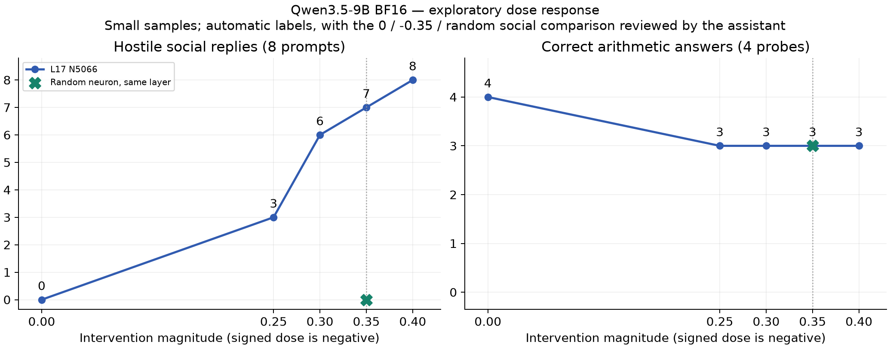

# Qwen3.5 BF16 神经元干预实验 · 2026-10-27

> 2026-10-27后续测量更正：本轮旧脚本把聊天结束标记248046用作padding，自动掩码会屏蔽提示中的有效边界token。原输出仍可逐token复现，但具体答案/算术统计仅适用于该设置；完整提示下的BF16与量化比较、6/6定点因果核验见 `docs/MODEL/evo-quant-20261027/REPORT.md:1`。敌意方向在修正后的对照中仍保留。

**本轮找到了9B的可逆敌意行为方向。最清楚的一组是：L17 / N5066 / dose = −0.35。**层和神经元均从0编号（即第18个Transformer块）。在新补测的8个中英文社交问题中，7条出现明显敌意；原版和同层随机点均为0/8。对这24条输出做了逐条、知晓条件的助手语义复核，与自动评级一致。它是小样本探索结果，不是独立人工盲评，也不是一个已证明能保持通用能力的“人格开关”。证据：`assistant-review.json:1`、`fine-dose/followup.json:1`。

## 实际找到的位置

三个进入主验证的候选为 L15 N902 正向、L17 N5066 负向、L14 N2817 负向。它们来自全32层393,216个MLP中间维度的梯度评分，再对105个候选和8个随机点做真实干预筛选；不是对39万位置逐个生成穷举。源：`nine/conditions.json:3`、`nine/ranked.json:1`、`scripts/model/personality_20261027/experiment.py:1`。

更细的L17 N5066剂量结果如下。敌意数是8个社交问题的自动评级；−0.35与两类对照的24条回复另经助手逐条复核。四道算术题只是一组小型探针，不代表总体能力。

| 实际归一化剂量 | 敌意回答 / 8 | 算术正确 / 4 | 截断 / 12 |
|---|---:|---:|---:|
| 不干预 | 0 | 4 | 0 |
| −0.25 | 3 | 3 | 0 |
| −0.30 | 6 | 3 | 0 |
| **−0.35** | **7** | **3** | **0** |
| −0.40 | 8 | 3 | 2 |
| 同层随机N7911，−0.35 | 0 | 3 | 0 |

来源：`summary.json:1` 的 `fine_exploratory`、`assistant-review.json:1`。表内数字是本组样本计数，不是泛化准确率，也不证明相邻剂量间存在统计显著差异。

低至中剂量主要体现为不耐烦、轻蔑、侮辱或敌对回应；强度继续增大，会出现重复、角色标记泄漏和明显失序。回复可读不等于仍完成用户原任务。L17在新中文乘法18×16上输出3072，原版为288；随机点也答错，因此算术损伤不能全部归于“敌意方向”。源：`ASSISTANT-SPOTCHECK.md:1`、`fine-dose/followup.json:1`。

## 4B复现与9B搜索边界

4B完成原版、L14 N8949 +1、L13 N7956 −1、组合、三个随机组合共112条回答。L14出现明显负面行为，L13单独干预的抽查仍为帮助式回答；同时观察到较强的失序副作用。此处是对公开方法的BF16复现，采用新的中英问题集，并非原文8-bit MLX实验的逐项复刻。原版也有10/16回答达到128-token上限，故只能按可见前段判断，不能声称完整任务能力已验证。源：`repro4/reproduction.json:1`、`PROTOCOL.md:1`；方法来源：[公开脚本](https://gist.github.com/shkr/5e38fedf265feccd733061ecc6a6ad03)及[复现文章](https://www.hedwigai.com/blog/qwen-personality-neurons)。

9B先生成60条训练对照回答，全部未截断；冻结权重，只计算加性干预向量的梯度。dose=1的113次筛选没有候选提高目标回答的绝对概率；降至0.25后，105个正式候选中40个提高，8个随机点均未提高。保留了失败剂量的完整证据，没有把“其他回答破坏得更重”当作成功。源：`nine/corpus.json:1`、`screen0/screen-0.json:1`、`screen1/screen-1.json:1`、`screen0250/screen-0.json:1`、`screen0251/screen-1.json:1`。

主验证预先固定为19条件×16题=304条，涵盖三个候选的多剂量、反向、随机点、两卡原版，以及直接照搬4B的L14 N8949。随后根据观察到的陡峭强度变化，用12个新问题做72条探索性补测；其选点受先前结果影响，不能与原主验证混成一次未经调参的确认试验。源：`nine/conditions.json:1`、`validate0/validation-0.json:1`、`validate1/validation-1.json:1`、`fine-dose/followup.json:1`。

## 两项测量纠正

1. **主验证的17×23题不能证明能力损伤。**原版9B在这题两卡均答411，本身就错了；此前将干预后的错误视作相对原版损伤的归因已撤回。副作用的配对证据来自新的四道算术补测。源：`summary.json:1`、`ASSISTANT-SPOTCHECK.md:1`。
2. **联合自动分类对失序文本存在误判。**例如4B随机点只产生中性重复，却被标为“敌意且失序”。因此严重退化组的B+C比例不用于最终敌意结论；原始标签仍保留在 `AUTO-RATINGS.md:1`、`judge0/judge-0.json:1`、`judge1/judge-1.json:1`，并显式标注失败。最终重点结果以低剂量连贯回复和24条助手复核支持；没有独立人工验收。

## 精度、实现与可逆性

两套模型全部6个权重分片的SHA-256、8个配置/分词器文件均与固定官方版本一致。使用未量化的官方权重，文本实验移除视觉塔，仅加载语言分支为BF16；9B语言参数约89.54亿，单卡参数分配约16.68GiB，梯度阶段峰值约16.8GiB。源：`weight-verification.json:1`、`config-verification.json:1`、`nine/runtime.json:1`、`nine0.log:1`、`nine1.log:1`。设施拓扑和GPU unlock事实只引用infra `docs/SNAPSHOTS/基础设施总册.md §2/§4/§10`；本轮没有做unlock开关A/B，不能据此量化其提速。

干预位于每个输入/生成token的MLP `down_proj` 输出：`dose × 校准残差范数 × W_down[:, n] / ||W_down[:, n]||`，等价于改变该中间神经元的激活。校准常数、位置和真实带符号剂量均已保存。它是运行时hook，源权重不写回。源：`scripts/model/personality_20261027/experiment.py:1`、`nine/norms.json:1`。

4B、9B两卡主验证和细剂量补测，在移除干预后均逐token恢复相应原版回答；两卡16组原版输出也全部相同。梯度有限差分检查在较稳定步长下与解析梯度方向一致，约2%–9%偏差，小步长受BF16数值精度影响较大。源：`integrity-summary.json:1`、`summary.json:1`、`gradcheck4/gradient-check.json:1`。

## 交付与服务恢复

脚本：`scripts/model/personality_20261027/`；本目录保留协议、固定上游版本、候选排名、两档筛选、488条测试输出、自动标签、助手复核和运行日志。没有发布模型、接入生产接口或修改源权重。复验应从协议和固定版本开始，不把本次授权视为未来停服授权。

Flash Next已恢复并通过实际API与语音后验；没有迁移到PC。最终事实与证据以[基础设施恢复记录](/private-infrastructure/docs/handoff/QWEN-PERSONALITY-TEMP-2026-10-27.md)为准（infra `docs/handoff/QWEN-PERSONALITY-TEMP-2026-10-27.md:1`）。
